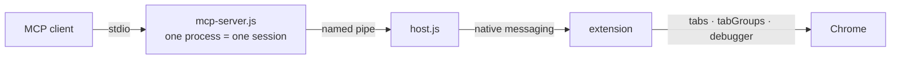

<p align="center">
  
</p>

<p align="center">
  <a href="LICENSE"></a>
  
  
  
  
  
  <a href="https://github.com/shaojunying/tabdeck/stargazers"></a>
</p>

<p align="center">
  <b>English</b> · <a href="README.zh-CN.md">中文</a>
</p>

---

**TabDeck lets a local AI agent drive your real, logged-in Chrome over MCP, with every task kept in its own named tab group.** A small Chrome extension plus a zero-dependency MCP server; works with Claude Code, Codex, Copilot CLI, Cursor or any other MCP client.

> [!NOTE]
> Inspired by [Claude in Chrome](https://claude.com/claude-in-chrome). TabDeck is an independent, model-agnostic take on the same idea. It is not affiliated with Anthropic and shares no code with that extension.

## ✨ Why

| | Your logged-in Chrome | No prompt per connection | Any model / client | Tidy agent tabs |
|---|:---:|:---:|:---:|:---:|
| Remote-debugging MCPs | ✅ | ❌ | ✅ | ❌ |
| Extension-relay MCPs | ✅ | ✅ | ✅ | ⚠️ |
| Claude in Chrome | ✅ | ✅ | ❌ | ✅ |
| **TabDeck** | ✅ | ✅ | ✅ | ✅ |

- 🗂️ **One tab group per session**, named after the task, in a color that stands apart.
- 🧲 **Tabs opened by a click stay in the group** and never steal the tab you are looking at.
- 🌙 **Works in background tabs**: clicking, typing and screenshots need no focus.
- 🔒 **Only touches its own tabs**, unless it explicitly adopts one of yours.
- 🔍 **Debugging built in**: console, network, dialogs, iframes and file uploads.
- 🪶 **No dependencies**: about 1,700 lines of plain JavaScript.

## 🎬 Demo

<p align="center">
  
</p>

<sub>Images on this page are illustrations, not captures of a real browser.</sub>

## 🚀 Install

Chrome 116+, Node.js 18+, Windows only for now.

```bash
git clone https://github.com/shaojunying/tabdeck.git
cd tabdeck
node scripts/setup.mjs
```

1. Open `chrome://extensions`, turn on **Developer mode**, **Load unpacked**, choose `extension/`.
2. Add the stdio server to your MCP client:

   ```json
   { "mcpServers": { "tabdeck": { "command": "node", "args": ["C:\\path\\to\\tabdeck\\src\\mcp-server.js"] } } }
   ```

   Claude Code: `claude mcp add tabdeck -- node C:\path\to\tabdeck\src\mcp-server.js`

Uninstall with `node scripts/setup.mjs --uninstall`, then remove the extension.

## 🧰 Tools

<details>
<summary><b>Tabs and groups</b> (10)</summary>

| Tool | What it does |
|---|---|
| `session_start` | Name this session's tab group after the task |
| `tabs_list` | List this session's tabs, or everything with `scope="all"` |
| `tab_open` | Open a tab in the group, in the background by default |
| `tabs_adopt` | Take over existing tabs by moving them into the group |
| `tabs_close` | Close tabs; only the session's own unless `force=true` |
| `tab_activate` | Switch to a tab |
| `tabs_group` / `tabs_ungroup` | General tab organising |
| `group_set` | Rename, recolor, collapse or expand a group |
| `session_end` | Close everything, dissolve the group, or keep it |

</details>

<details>
<summary><b>Pages</b> (17)</summary>

| Tool | What it does |
|---|---|
| `page_navigate` | Load a URL and wait for it |
| `page_snapshot` | Read the page, iframes included, as a compact accessibility tree with element refs |
| `page_click` | Click by ref; reports tabs the click opened |
| `page_type` | Type into a field by ref, optional Enter |
| `page_key` | Press a key |
| `page_select` | Choose options in a native `<select>` |
| `page_fill` | Fill several fields in one call: text, selects, checkboxes |
| `page_upload` | Choose local files in a file input |
| `page_dialog` | Accept or dismiss an alert, confirm or prompt |
| `page_hover` | Hover an element |
| `page_scroll` | Scroll by a screen, to top / bottom, or to an element |
| `page_history` | Back, forward, reload |
| `page_wait` | Wait for text to appear or disappear |
| `page_eval` | Run a JavaScript expression in the page |
| `page_screenshot` | JPEG of the visible area, at most 1280px wide |
| `page_console` | Console output and uncaught errors, including earlier ones |
| `page_network` | Requests the tab made; headers and bodies for one request |

</details>

<details>
<summary><b>Web search</b> (1)</summary>

| Tool | What it does |
|---|---|
| `web_search` | Search the web with no API key: opens a background tab on Google (Bing if Google shows a captcha or nothing), returns title, URL and snippet for up to 10 results, then closes the tab |

</details>

## 🧩 How it works



Page actions use `chrome.debugger`, so Chrome shows its "started debugging this browser" bar while a session is acting on a page.

## 🛡️ Limits and security

> [!WARNING]
> The agent has the same access to a page as you, including your logins. Use it only with agents and prompts you trust; web pages can contain text written to mislead an agent.

- Not yet: macOS / Linux, per-site allowlist, screen recording.
- `page_network` only sees requests made after TabDeck first acted on the tab, and redacts cookie and authorization headers.
- `page_upload` refuses files that look like credentials or keys. This is a guard against slips, not a security boundary.
- `page_eval` runs arbitrary JavaScript in session tabs.
- `web_search` reads the search engine's result page, so it runs as you (your region, language and account) and can break when that page's markup changes. Many searches in quick succession can trigger a captcha; `npm run test:search` checks it against the live sites.
- `chrome://` pages and the Chrome Web Store cannot be driven.

<details>
<summary><b>Development and troubleshooting</b></summary>

- `node test/plumbing.test.mjs` tests the server and host without Chrome; `npm run test:live` runs against your real Chrome with temporary tabs.
- `node scripts/reload.mjs` reloads the extension after you change `extension/`, with no Chrome prompt.
- `Cannot reach the TabDeck extension`: Chrome is not running, the extension is not loaded, or setup has not been run.
- `Specified native messaging host not found`: you ran setup from a shell inside a packaged (MSIX) app, which writes to a private registry view. Rerun it with `--via-wmi`.
- Logs: `native-host/host.log`, and the "service worker" link on the TabDeck card in `chrome://extensions`.

</details>

## 📄 License

[MIT](LICENSE)
