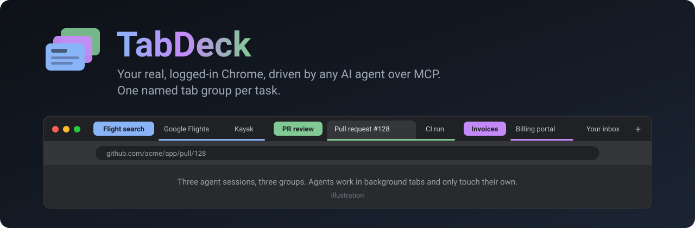
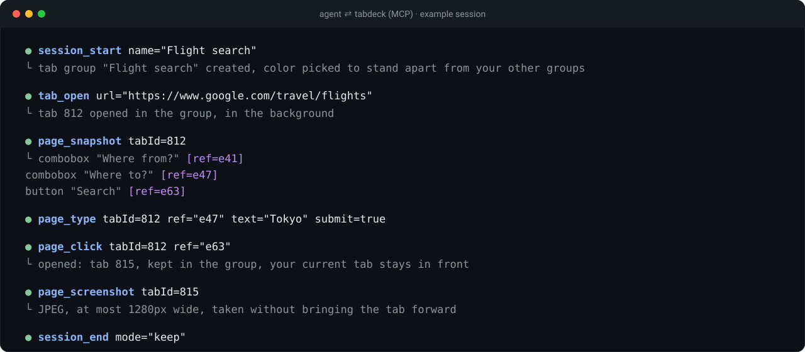
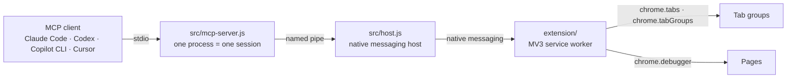

<p align="center">
  
</p>

<p align="center">
  <a href="LICENSE"></a>
  
  
  
  
  
  
  
  <a href="https://github.com/shaojunying/tabdeck/stargazers"></a>
</p>

<p align="center">
  <b>English</b> · <a href="README.zh-CN.md">中文</a>
</p>

<p align="center">
  <a href="#-why">Why</a> ·
  <a href="#-what-a-session-looks-like">Demo</a> ·
  <a href="#-install">Install</a> ·
  <a href="#-tools">Tools</a> ·
  <a href="#-how-it-works">How it works</a> ·
  <a href="#-security-notes">Security</a>
</p>

---

**TabDeck lets a local AI agent drive your real, logged-in Chrome over MCP, with every task kept in its own named tab group.**

It is a small Chrome extension plus a zero-dependency MCP server. Any MCP client (Claude Code, Codex, Copilot CLI, Cursor, ...) can open tabs, read pages, click, type and take screenshots in the browser you already use, with your existing logins, and without a permission prompt on every connection.

> [!NOTE]
> **Inspired by [Claude in Chrome](https://claude.com/claude-in-chrome).** TabDeck is an open, model-agnostic take on the same idea: an extension that lets an agent work in your own browser, in a tab group of its own. It is an independent project, not affiliated with or endorsed by Anthropic, written from public documentation only and sharing no code with that extension.

## ✨ Why

Existing options each miss something:

| | Uses your logged-in Chrome | No prompt per connection | Any model / any MCP client | Keeps agent tabs organised |
|---|:---:|:---:|:---:|:---:|
| Remote-debugging based MCPs | ✅ | ❌ Chrome asks every time | ✅ | ❌ |
| Extension-relay MCPs | ✅ | ✅ | ✅ | ⚠️ fixed group name, new tabs escape |
| Vendor extensions such as Claude in Chrome | ✅ | ✅ | ❌ that vendor's agent only | ✅ |
| **TabDeck** | ✅ | ✅ | ✅ | ✅ |

What TabDeck does differently:

- 🗂️ **One tab group per session, named after the task.** No fixed prefix. Colors are picked so that concurrent groups do not look alike, and duplicate names get a number.
- 🧲 **Tabs opened by a click stay in the group** and are reported back to the agent, without stealing the tab you are looking at.
- 🌙 **The agent works in background tabs.** Clicking, typing and screenshots do not need the tab in front.
- 🔒 **The agent can only touch its own tabs.** To act on a tab you already have open, it must adopt it explicitly.
- 🧹 **Polite cleanup.** When the client exits, blank tabs are closed and tabs with content are left for you.
- 🪶 **No npm dependencies.** About 1,200 lines of plain JavaScript you can read in one sitting.

## 🎬 What a session looks like

<p align="center">
  
</p>

The agent names the task, gets a tab group, reads pages as a compact accessibility tree with element refs, and acts on those refs. The images on this page are illustrations of the behaviour, not captures of a real browser.

## 🚀 Install

Requirements: Chrome 116+, Node.js 18+. **Windows only for now** (the host registration and the pipe are Windows-specific; macOS / Linux support is not written yet).

1. Clone this repository.

   ```bash
   git clone https://github.com/shaojunying/tabdeck.git
   ```

2. Register the native messaging host:

   ```bash
   node scripts/setup.mjs
   ```

   If you run this from a shell inside a packaged (MSIX) app, such as a desktop AI app's built-in terminal, add `--via-wmi`. Those shells write `HKCU` into a private registry view that Chrome cannot see, and the extension then reports `Specified native messaging host not found`.

3. Open `chrome://extensions`, turn on **Developer mode**, click **Load unpacked** and choose the `extension/` folder. The extension id should be `akjjdilmpbopldfdljbhimajnkbhjhep`.

4. Add the MCP server to your client. It is a stdio server:

   ```json
   {
     "mcpServers": {
       "tabdeck": { "type": "stdio", "command": "node", "args": ["C:\\path\\to\\tabdeck\\src\\mcp-server.js"] }
     }
   }
   ```

   Claude Code: `claude mcp add tabdeck -- node C:\path\to\tabdeck\src\mcp-server.js`

Uninstall: `node scripts/setup.mjs --uninstall`, then remove the extension in `chrome://extensions`.

## 🧰 Tools

<details open>
<summary><b>Tabs and groups</b> (10)</summary>

| Tool | What it does |
|---|---|
| `session_start` | Name this session's tab group after the task |
| `tabs_list` | List this session's tabs, or every tab and group with `scope="all"` |
| `tab_open` | Open a tab in the session's group (in the background by default) |
| `tabs_adopt` | Take over existing tabs by moving them into the session's group |
| `tabs_close` | Close tabs; only the session's own unless `force=true` |
| `tab_activate` | Switch to a tab |
| `tabs_group` / `tabs_ungroup` | General tab organising |
| `group_set` | Rename, recolor, collapse or expand a group |
| `session_end` | Finish: close everything, dissolve the group, or keep it |

</details>

<details open>
<summary><b>Pages</b> (12, session tabs only)</summary>

| Tool | What it does |
|---|---|
| `page_navigate` | Load a URL and wait for it |
| `page_snapshot` | Read the page as a compact accessibility tree; actionable elements carry a ref such as `e42` |
| `page_click` | Click by ref; reports tabs the click opened |
| `page_type` | Type into a field by ref; replaces by default, optional Enter |
| `page_key` | Press a key (Enter, Tab, Escape, arrows, ...) |
| `page_select` | Choose options in a native `<select>` |
| `page_hover` | Hover an element |
| `page_scroll` | Scroll by a screen, to top / bottom, or to an element |
| `page_history` | Back, forward, reload |
| `page_wait` | Wait for text to appear or disappear |
| `page_eval` | Run a JavaScript expression in the page |
| `page_screenshot` | JPEG of the visible area, at most 1280px wide |

</details>

## 🧩 How it works



The extension talks to a local host process through Chrome native messaging. Each MCP server process is one session. Page actions go through `chrome.debugger`, so Chrome shows its "TabDeck started debugging this browser" bar while a session is acting on a page.

## 🚧 Limits

- Windows only.
- Main frame only: content inside iframes is not in the snapshot.
- No file upload, no console or network inspection yet.
- `chrome.debugger` cannot attach to `chrome://` pages or the Chrome Web Store.

## 🛡️ Security notes

> [!WARNING]
> The agent gets the same access to a page as you have, including your logged-in sessions. Only use it with agents and prompts you trust, and remember that web pages can contain text written to mislead an agent.

- `page_eval` runs arbitrary JavaScript in session tabs.
- The named pipe uses default permissions; the tool is meant for a single-user machine.
- There is no per-site allowlist yet.

## 🛠️ Development

- `node test/plumbing.test.mjs` checks the MCP server and host without Chrome.
- `node test/live.test.mjs`, `live2`, `live3` run against your real Chrome. They open a few temporary tabs (the page tests use a local test page) and close them afterwards.
- `node scripts/reload.mjs` reloads the extension over TabDeck's own channel after you change files under `extension/`, with no Chrome prompt.
- `node scripts/sw-eval.mjs "<code>"` runs code inside the extension's service worker through the remote debugging port (Chrome asks for permission each time).

## 🩺 Troubleshooting

- `Cannot reach the TabDeck extension`: Chrome is not running, the extension is not loaded, or setup has not been run. The extension retries the host every 30 seconds.
- `Specified native messaging host not found` in the service worker console: the registry entry is not visible to Chrome; see the `--via-wmi` note above.
- Host log: `native-host/host.log`. Extension log: the "service worker" link on the TabDeck card in `chrome://extensions`.

## 🙏 Acknowledgements

- [Claude in Chrome](https://claude.com/claude-in-chrome) for the idea of an agent working in its own tab group inside your browser.
- The [Model Context Protocol](https://modelcontextprotocol.io) for making one server usable from every client.

## 📄 License

[MIT](LICENSE)
