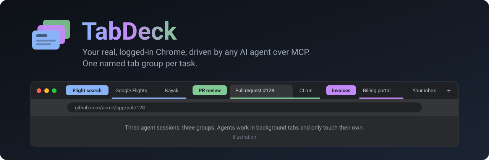
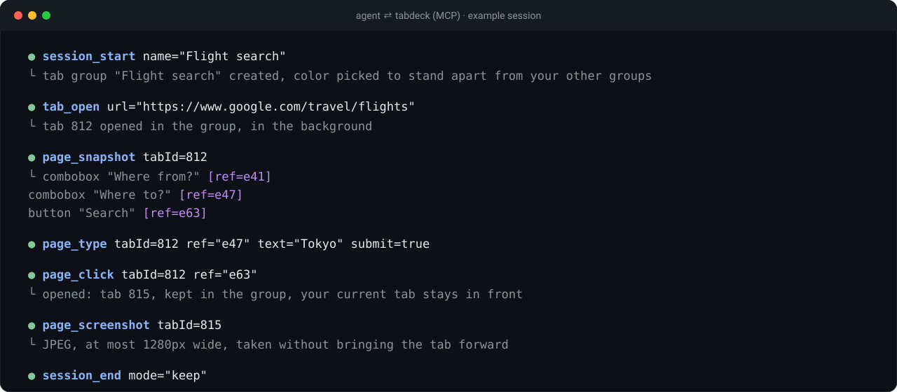
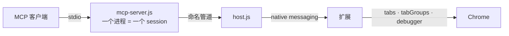

<p align="center">
  
</p>

<p align="center">
  <a href="LICENSE"></a>
  
  
  
  
  
  <a href="https://github.com/shaojunying/tabdeck/stargazers"></a>
</p>

<p align="center">
  <a href="README.md">English</a> · <b>中文</b>
</p>

---

**TabDeck 让本地 AI agent 通过 MCP 操作你真实的、已登录的 Chrome，每个任务放在一个按任务命名的标签页组里。** 一个 Chrome 扩展加一个零依赖的 MCP server，Claude Code、Codex、Copilot CLI、Cursor 等任何 MCP 客户端都能用。

> [!NOTE]
> 灵感来自 [Claude in Chrome](https://claude.com/claude-in-chrome)。TabDeck 是同一思路的独立实现，不绑定模型；与 Anthropic 无关联，也没有使用该扩展的任何代码。

## ✨ 为什么做

| | 用你已登录的 Chrome | 连接时不弹确认 | 任意模型 / 客户端 | 标签页有条理 |
|---|:---:|:---:|:---:|:---:|
| 远程调试类 MCP | ✅ | ❌ | ✅ | ❌ |
| 扩展中继类 MCP | ✅ | ✅ | ✅ | ⚠️ |
| Claude in Chrome | ✅ | ✅ | ❌ | ✅ |
| **TabDeck** | ✅ | ✅ | ✅ | ✅ |

- 🗂️ **每个 session 一个标签页组**，以任务命名，颜色自动与别的组区分。
- 🧲 **点击开出的新标签页留在组里**，不抢你正在看的标签页。
- 🌙 **在后台标签页里干活**：点击、输入、截图都不用切到前台。
- 🔒 **只动自己的标签页**，要动你的标签页必须先明确收编。
- 🔍 **自带调试能力**：console、网络请求、弹窗、iframe、文件上传。
- 🪶 **零依赖**：约 1700 行纯 JavaScript。

## 🎬 演示

<p align="center">
  
</p>

<sub>本页的图是示意图，不是真实浏览器的截图。</sub>

## 🚀 安装

需要 Chrome 116+、Node.js 18+，目前只支持 Windows。

```bash
git clone https://github.com/shaojunying/tabdeck.git
cd tabdeck
node scripts/setup.mjs
```

1. 打开 `chrome://extensions`，开启“开发者模式”，点“加载已解压的扩展程序”，选 `extension/` 目录。
2. 在 MCP 客户端里加一个 stdio server：

   ```json
   { "mcpServers": { "tabdeck": { "command": "node", "args": ["C:\\path\\to\\tabdeck\\src\\mcp-server.js"] } } }
   ```

   Claude Code：`claude mcp add tabdeck -- node C:\path\to\tabdeck\src\mcp-server.js`

卸载：`node scripts/setup.mjs --uninstall`，再移除扩展。

## 🧰 工具

<details>
<summary><b>标签页和组</b>（10 个）</summary>

| 工具 | 作用 |
|---|---|
| `session_start` | 给本 session 的组按任务起名 |
| `tabs_list` | 列出本 session 的标签页；`scope="all"` 列出全部 |
| `tab_open` | 在组里开新标签页，默认在后台 |
| `tabs_adopt` | 把已有标签页收进本 session 的组 |
| `tabs_close` | 关标签页，默认只能关本 session 的 |
| `tab_activate` | 切到某个标签页 |
| `tabs_group` / `tabs_ungroup` | 通用整理：进组、出组 |
| `group_set` | 改组名、颜色、折叠状态 |
| `session_end` | 结束：全部关掉、只解散组，或原样保留 |

</details>

<details>
<summary><b>页面操作</b>（17 个）</summary>

| 工具 | 作用 |
|---|---|
| `page_navigate` | 打开网址并等加载完 |
| `page_snapshot` | 把页面（含 iframe）读成紧凑的无障碍树，可操作的元素带 ref |
| `page_click` | 按 ref 点击，并报告点击开出的新标签页 |
| `page_type` | 按 ref 输入文字，可选回车 |
| `page_key` | 按一个键 |
| `page_select` | 在原生下拉框里选中选项 |
| `page_fill` | 一次填多个字段：文本框、下拉框、复选框 |
| `page_upload` | 在文件输入框里选中本地文件 |
| `page_dialog` | 确认或取消 alert、confirm、prompt 弹窗 |
| `page_hover` | 悬停到元素上 |
| `page_scroll` | 滚一屏、到顶 / 到底，或滚到某个元素 |
| `page_history` | 后退、前进、刷新 |
| `page_wait` | 等某段文字出现或消失 |
| `page_eval` | 在页面里执行一段 JavaScript |
| `page_screenshot` | 截当前可见区域，JPEG，最宽 1280 像素 |
| `page_console` | console 输出和未捕获的异常，包括之前的记录 |
| `page_network` | 标签页发出的请求；单个请求的请求头、响应头和正文 |

</details>

## 🧩 工作原理



页面操作经 `chrome.debugger` 实现，所以 session 操作页面时 Chrome 顶部会出现“已开始调试此浏览器”的提示条。

## 🛡️ 限制与安全

> [!WARNING]
> agent 对页面的访问权限和你一样，包括你的登录态。只给你信任的 agent 和提示词使用；网页里可能有专门误导 agent 的文字。

- 还不支持：macOS / Linux、按站点授权、录屏。
- `page_network` 只能看到 TabDeck 第一次操作这个标签页之后发出的请求，cookie 和 authorization 请求头会打码。
- `page_upload` 会拒绝看起来像凭据或密钥的文件。这只是防手滑，不是安全边界。
- `page_eval` 会在 session 的标签页里执行任意 JavaScript。
- `chrome://` 页面和 Chrome 应用商店不能操作。

<details>
<summary><b>开发与排查</b></summary>

- `node test/plumbing.test.mjs` 不需要 Chrome，测 server 和 host；`npm run test:live` 在你的真实 Chrome 里跑，会临时开几个标签页。
- 改了 `extension/` 下的代码后跑 `node scripts/reload.mjs` 重载扩展，Chrome 不弹窗。
- `Cannot reach the TabDeck extension`：Chrome 没开、扩展没加载，或者没跑过 setup。
- `Specified native messaging host not found`：setup 是在打包应用（MSIX）里的 shell 跑的，注册表写进了应用私有视图。加 `--via-wmi` 重跑。
- 日志：`native-host/host.log`，以及 `chrome://extensions` 里 TabDeck 卡片上的“Service Worker”链接。

</details>

## 📄 License

[MIT](LICENSE)
